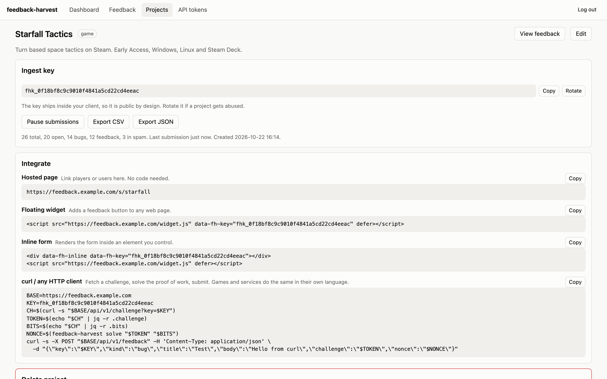
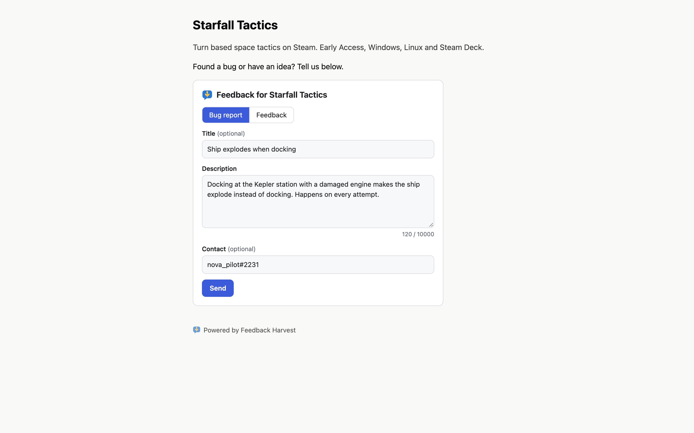
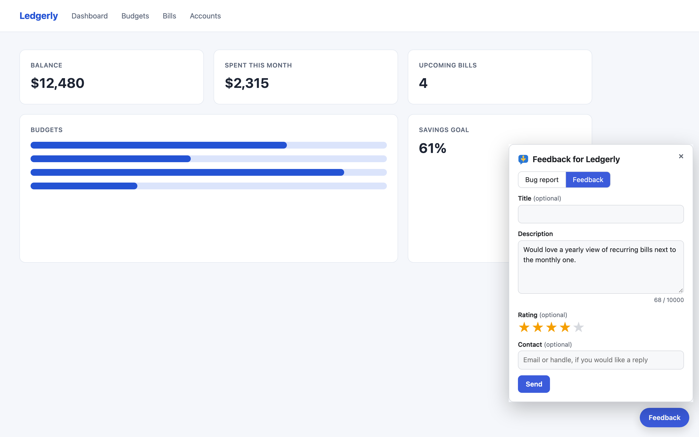

<div align="center">

<picture>
  <source media="(prefers-color-scheme: dark)" srcset="docs/assets/logo-dark.svg">
  
</picture>

### Let your players give you an earful.

Bug reports, crash logs and feedback from everything you ship.<br>One 10 MB self-hosted binary. No accounts. No CAPTCHAs. No spam.

[](https://github.com/georgevibing/earful/actions/workflows/ci.yml)
[](LICENSE)
[](https://www.rust-lang.org)
[](https://sqlite.org)
[](docs/mcp.md)
[](CONTRIBUTING.md)

[Quickstart](#-quickstart) ·
[Features](#-features) ·
[Integrate](#-drop-it-into-your-product) ·
[Anti-spam](#%EF%B8%8F-spam-protection-without-captchas) ·
[Agents](#-let-your-agent-triage) ·
[Docs](docs/)

<br>

<picture>
  <source media="(prefers-color-scheme: dark)" srcset="docs/assets/inbox-dark.png">
  
</picture>

</div>

## Why Earful?

You shipped a game, a web app or a CLI. Now you want to hear from the people using it, without making them sign up, without paying per seat for a SaaS inbox, and without wading through bot spam.

Earful is a self-hosted inbox for exactly that. Players and users report bugs **anonymously** through a hosted page, a one-line widget or a plain HTTP API. Nine layers of invisible anti-spam keep scripts out. You find anything again with typo-tolerant, keyword and **semantic search that runs fully offline**. And your coding agent can triage the whole inbox for you over **MCP**.

|  | Earful | GitHub Issues | SaaS feedback tools |
| --- | :---: | :---: | :---: |
| Reporters need an account | **No** | Yes | Often |
| Self-hosted, your data stays yours | **Yes** | No | No |
| Runs on a $5 VPS (about 10 MB RAM idle) | **Yes** | n/a | n/a |
| Spam protection without CAPTCHAs | **Yes** | n/a | Varies |
| Crash and log reports from games | **Yes** | No | Rarely |
| Semantic search with no external API | **Yes** | No | No |
| Built-in MCP server for AI agents | **Yes** | Third party | Rarely |
| Price | **Free, MIT** | Free | Monthly |

## 🚀 Quickstart

You need Docker. Three commands and you have an inbox:

```sh
git clone https://github.com/georgevibing/earful && cd earful
printf "EARFUL_ADMIN_PASSWORD_HASH='%s'\n" "$(printf '%s' 'choose-a-long-password' | docker run --rm -i $(docker build -q .) hash-password)" > .env
docker compose up -d --build
```

Open **http://127.0.0.1:8080/admin/**, sign in, create a project and copy its snippet. Done.

The compose file binds to `127.0.0.1` only. For a public instance put it behind an HTTPS proxy: see [Deploy](#-deploy).

<details>
<summary><b>Build from source instead</b></summary>

<br>

Prerequisites: Rust stable (rustup), Node 22+ and pnpm (`corepack enable`).

```sh
pnpm install
pnpm build:web                       # widget + admin UI, embedded into the binary
cargo build --release

export EARFUL_ADMIN_PASSWORD_HASH="$(printf '%s' 'choose-a-long-password' | ./target/release/earful hash-password)"
export EARFUL_COOKIE_SECURE=false        # plain http on localhost only
./target/release/earful download-model   # optional: offline semantic search
./target/release/earful serve
```

The server listens on `127.0.0.1:8080`. Without `EARFUL_ADMIN_PASSWORD_HASH` every login fails, by design.

</details>

## ✨ Features

- **📥 Collect from anywhere.** A hosted page at `/s/<slug>`, an embeddable widget (about 9 KB gzipped, Shadow DOM, light and dark), or the HTTP API from Unity, Godot, C++, Python or `curl`.
- **💥 Bugs, feedback, crashes, exceptions and logs.** Attach version, platform and GPU in `meta`, and up to 64 KB of stack traces and log tails in `diagnostics`. See the [crash reporting guide](docs/crash-reporting.md).
- **🛡️ Spam-proof without friction.** Proof of work, signed single-use challenges, rate limits, a honeypot, heuristics and near-duplicate detection. No CAPTCHA, no account.
- **🔎 Find anything.** Fuzzy (`invetnory crsh` finds "Inventory crash"), BM25 keyword, semantic, and a hybrid mode that fuses all three. "Similar reports" on every item makes duplicates obvious.
- **🏷️ Triage fast.** Status tabs, multi-label filters (all/any/unlabeled), bulk actions, keyboard shortcuts, notes, a themes dashboard, CSV and JSON export.
- **🤖 Agent-ready.** A built-in MCP server with 23 tools and 4 prompts lets Claude Code, Cursor or VS Code triage, label, de-duplicate and write release notes.
- **🪶 Tiny and boring to run.** One Rust binary with the UI embedded, one SQLite file, no Redis, no Postgres, no queue. A distroless Docker image with a health check.
- **🔒 Private by default.** Raw IPs are never stored (keyed HMAC pseudonyms only), there's a single argon2id admin login, a strict CSP, and it binds localhost unless told otherwise.

<table>
  <tr>
    <td width="50%">
      <picture>
        <source media="(prefers-color-scheme: dark)" srcset="docs/assets/dashboard-dark.png">
        
      </picture>
      <p align="center"><b>Dashboard</b>: activity, blocked spam, themes</p>
    </td>
    <td width="50%">
      <picture>
        <source media="(prefers-color-scheme: dark)" srcset="docs/assets/project-dark.png">
        
      </picture>
      <p align="center"><b>Project</b>: ingest key and ready-to-paste snippets</p>
    </td>
  </tr>
  <tr>
    <td width="50%">
      <picture>
        <source media="(prefers-color-scheme: dark)" srcset="docs/assets/hosted-dark.png">
        
      </picture>
      <p align="center"><b>Hosted page</b>: share a link, no code needed</p>
    </td>
    <td width="50%">
      <picture>
        <source media="(prefers-color-scheme: dark)" srcset="docs/assets/widget-dark.png">
        
      </picture>
      <p align="center"><b>Widget</b>: one script tag on any site</p>
    </td>
  </tr>
</table>

<sub>Screenshots follow your GitHub theme and are generated from seeded demo data by <a href="scripts/screenshots.mjs"><code>scripts/screenshots.mjs</code></a>.</sub>

## 🔌 Drop it into your product

Create a project in the admin UI and copy its ingest key. The key ships inside your game or page, so it is public by design (rotate it any time). The project page shows every snippet below, prefilled.

**No code:** link to `https://<your-host>/s/<slug>` from your game menu, store page or Discord.

**Any website:** one script tag adds a floating feedback button:

```html
<script src="https://<your-host>/widget.js" data-earful-key="ear_..." defer></script>
```

Prefer an inline form? Use `<div data-earful-inline data-earful-key="ear_..."></div>`. Bundler users get an ESM client: see [packages/widget](packages/widget/README.md).

**Games and native apps:** fetch a challenge, solve a small proof of work, submit:

```sh
BASE=https://<your-host> KEY=ear_...
CH=$(curl -s "$BASE/api/v1/challenge?key=$KEY")
TOKEN=$(echo "$CH" | jq -r .challenge) BITS=$(echo "$CH" | jq -r .bits)
NONCE=$(earful solve "$TOKEN" "$BITS")
curl -s "$BASE/api/v1/feedback" -H 'Content-Type: application/json' -d @- <<EOF
{"key":"$KEY","kind":"bug","title":"Crash on launch","body":"Black screen, then crash to desktop.",
 "meta":{"version":"1.2.3","platform":"windows"},"challenge":"$TOKEN","nonce":"$NONCE"}
EOF
```

Copy-paste examples for **Unity (C#), Godot 4, C++ and Python** are in [docs/integrations.md](docs/integrations.md). The full HTTP contract is [docs/api.md](docs/api.md).

## 🛡️ Spam protection without CAPTCHAs

Every submission runs through a fixed pipeline. Errors a real client needs to know about are returned. Everything else answers `202 {"ok": true}`, so spammers never learn what got caught, and soft signals quarantine instead of reject, so you never lose a real report.

| Layer | What it does | On failure |
| --- | --- | --- |
| Ingest key | Scopes every request to one project; rotatable, pausable | `404` / `403` |
| Honeypot | Hidden field only bots fill in | Silently dropped |
| Validation | Length caps, UTF-8, control characters stripped | `400` |
| Rate limits | Sliding windows per IP and project, per IP globally, per project globally | `429` + `Retry-After` |
| Proof of work | SHA-256 puzzle, about 0.2 s in a browser, harder for repeat senders and under load | `400` |
| Single-use challenge | HMAC-signed, project-bound, expires after 30 minutes | `400` |
| Minimum fill time | Submitted less than 2 s after the challenge | Quarantined |
| Exact duplicate | Same text within 24 h: dropped from the same IP, merged (`+1`) from another | Dropped or merged |
| Heuristics | Links, shorteners, spam phrases, shouting, repetition | Quarantined |
| Near duplicate | Paraphrased repeats from one IP (embedding similarity ≥ 0.95) | Quarantined |

Quarantined items wait in the **Spam** tab, one click from being restored. The reasoning behind each layer is in [docs/architecture.md](docs/architecture.md).

## 🔎 Search that understands players

| Mode | How | Best for |
| --- | --- | --- |
| `hybrid` (default) | Reciprocal rank fusion of the three below | Everyday searching |
| `fuzzy` | FTS5 trigrams + typo-tolerant edit distance | Half-remembered words, typos |
| `keyword` | FTS5 with Porter stemming, BM25 ranked | Error strings, exact terms |
| `semantic` | Cosine similarity over embeddings | "game freezes" → "stuck on the loading screen" |

Semantic search works **offline out of the box**: the Docker image bundles the 31 MB [Model2Vec](https://github.com/MinishLab/model2vec) `potion-base-8M` model (no GPU, no API, about 13 µs per embedding). It finds "the Steam trophy never popped" for "achievement didn't unlock", and "billed two times" for "refund for double payment". Want more? Point it at OpenAI, Ollama or any OpenAI-compatible `/embeddings` endpoint.

<details>
<summary><b>Embedding providers and benchmark</b></summary>

<br>

| Provider | What it is | Cost | Quality |
| --- | --- | --- | --- |
| `model2vec` | Local static embeddings, default [`minishlab/potion-base-8M`](https://huggingface.co/minishlab/potion-base-8M) (MIT, 256 dims) | About 80 MB RAM, loads in about 20 ms | Real semantic matches |
| `hash` | Feature hashing over stems, bigrams and trigrams plus a small game/app concept map | Nothing | Lexical with a little help |
| `openai` | Any OpenAI-compatible API: OpenAI, Ollama, LM Studio, vLLM, llama.cpp | API fees or a model server | Best |
| `none` | Semantic search off; keyword and fuzzy still work | Nothing | n/a |

`EARFUL_EMBED_PROVIDER=auto` (default) uses Model2Vec when a model exists at `EARFUL_EMBED_MODEL_PATH`, otherwise `hash`. Embeddings are computed in the background, so submissions never wait. Vectors are tagged with their model, so switching providers re-embeds everything automatically.

On 17 paraphrase queries over 18 realistic reports (`crates/server/tests/model2vec.rs`), potion-base-8M reaches an MRR of **0.81** against 0.61 for `hash`. The larger `potion-retrieval-32M` scored 0.73 on this data, so the small model stays the default.

</details>

## 🤖 Let your agent triage

Earful serves an MCP endpoint at `/mcp`. Create a token under **API tokens**, then:

```sh
claude mcp add --transport http earful https://<your-host>/mcp \
  --header "Authorization: Bearer <token>"
```

Then just ask: *"Triage the new feedback for starfall, group it into themes and label the duplicates."*

| | |
| --- | --- |
| Read tools (10) | `list_projects`, `get_project`, `list_feedback`, `search_feedback`, `get_feedback`, `find_similar_feedback`, `list_labels`, `get_stats`, `export_feedback`, `get_integration_snippets` |
| Write tools (13) | `create_feedback`, `update_feedback`, `bulk_update_feedback`, `delete_feedback`, `create_label`, `update_label`, `delete_label`, `label_feedback`, `create_project`, `update_project`, `rotate_project_key`, `delete_project`, `reindex_embeddings` |
| Prompts | `triage_inbox`, `group_feedback_themes`, `summarize_feedback`, `release_notes_from_resolved` |

Tokens are scoped (`read` or `write`), hashed and revocable. Read tokens never see write tools, and destructive tools require explicit confirmation. Stdio-only clients such as Claude Desktop use the built-in `earful mcp-stdio` bridge. Setup for every client: [docs/mcp.md](docs/mcp.md) and [docs/agent-themes.md](docs/agent-themes.md).

## 📦 Deploy

Any container host works. The image runs as non-root on distroless, binds `0.0.0.0:8080` inside the container, stores everything under `/data` and ships a `HEALTHCHECK`.

1. Build from this repository's `Dockerfile` (Coolify, Dokploy, CapRover, Fly.io, plain Docker).
2. Mount a persistent volume at `/data`.
3. Set `EARFUL_ADMIN_PASSWORD_HASH` (and optionally the embedding variables).
4. Put an HTTPS reverse proxy in front. **Never publish port 8080 directly.**

Step-by-step Coolify instructions, Cloudflare notes, an optional Ollama sidecar, backups and upgrades: [docs/deploy-coolify.md](docs/deploy-coolify.md).

<details>
<summary><b>Configuration</b> (all environment variables)</summary>

<br>

[.env.example](.env.example) is a commented template.

| Variable | Default | Purpose |
| --- | --- | --- |
| `EARFUL_BIND` | `127.0.0.1:8080` | Listen address. The Docker image sets `0.0.0.0:8080` inside the container. |
| `EARFUL_DATABASE_PATH` | `earful.db` | SQLite file. Image default `/data/earful.db`. |
| `EARFUL_ADMIN_PASSWORD_HASH` | unset | Argon2 PHC string from `earful hash-password`. Unset means every login is rejected. |
| `EARFUL_ADMIN_PASSWORD_HASH_FILE` | unset | File containing the hash. Takes precedence. |
| `EARFUL_SESSION_TTL_HOURS` | `168` | Admin session lifetime. |
| `EARFUL_COOKIE_SECURE` | `true` | `Secure` flag on the session cookie. Only disable for plain http on localhost. |
| `EARFUL_TRUSTED_PROXY_HOPS` | `0` | Reverse proxies to trust for `X-Forwarded-For`. Image default `1`. |
| `EARFUL_LIMIT_IP_PROJECT_MINUTE` | `3` | Submissions per IP per project per minute. |
| `EARFUL_LIMIT_IP_PROJECT_HOUR` | `10` | Per IP per project per hour. |
| `EARFUL_LIMIT_IP_PROJECT_DAY` | `30` | Per IP per project per day. |
| `EARFUL_LIMIT_IP_GLOBAL_DAY` | `60` | Per IP across all projects per day. |
| `EARFUL_LIMIT_PROJECT_HOUR` | `300` | Per project across all IPs per hour (flood guard). Beyond it submissions are quarantined; at 3x they are refused. |
| `EARFUL_LIMIT_GLOBAL_DAY` | `5000` | Submissions per day across every project and IP (protects the disk). |
| `EARFUL_SPAM_RETENTION_DAYS` | `30` | Quarantined items older than this are purged. `0` keeps them forever. |
| `EARFUL_LIMIT_CHALLENGES_IP_HOUR` | `60` | Challenges issued per IP per hour. |
| `EARFUL_MIN_FILL_SECS` | `2` | Submissions faster than this after the challenge are quarantined. |
| `EARFUL_SPAM_THRESHOLD` | `0.7` | Heuristic score that sends a submission to the spam bucket. |
| `EARFUL_POW_BITS` | `18` | Base proof of work difficulty (leading zero bits). |
| `EARFUL_POW_MAX_BITS` | `23` | Upper bound for adaptive difficulty. |
| `EARFUL_CHALLENGE_TTL_SECS` | `1800` | Challenge lifetime. |
| `EARFUL_EMBED_PROVIDER` | `auto` | `auto`, `model2vec`, `hash`, `openai` or `none`. |
| `EARFUL_EMBED_MODEL_PATH` | `models/potion-base-8M` (Docker: `/models/potion-base-8M`) | Model2Vec model directory. |
| `EARFUL_EMBED_AUTO_DOWNLOAD` | `false` | With `model2vec`, download a missing model from Hugging Face at startup. |
| `EARFUL_EMBED_DIM` | `384` | Vector size for the `hash` provider. |
| `EARFUL_EMBED_URL` | `https://api.openai.com/v1` | Base URL of an OpenAI-compatible API. |
| `EARFUL_EMBED_MODEL` | `text-embedding-3-small` (`openai`), `minishlab/potion-base-8M` (`model2vec`) | Model name, or the Hugging Face repo for auto download. |
| `EARFUL_EMBED_API_KEY` / `EARFUL_EMBED_API_KEY_FILE` | unset | Bearer token for the embedding API. |
| `RUST_LOG` | `info` | Log filter (tracing `EnvFilter` syntax). |

Admin logins are limited to 5 failures per 15 minutes per IP, failed MCP token attempts to 20 per 15 minutes per IP.

</details>

<details>
<summary><b>Security model</b></summary>

<br>

- **One admin.** argon2id password, random 256-bit sessions stored only as SHA-256, `HttpOnly` + `SameSite=Strict` + `Secure` cookies, cross-origin admin writes rejected. No configured hash means no login.
- **Public by design, guarded by layers.** The ingestion API is unauthenticated because anonymous players are its audience; the anti-spam pipeline protects it.
- **Private by default.** Binds `127.0.0.1` unless told otherwise. Always go through an HTTPS proxy.
- **Strict headers.** `self`-only CSP and `X-Frame-Options: DENY` on the admin UI, `nosniff` and `no-referrer` everywhere.
- **No raw IPs.** Only keyed HMAC pseudonyms (IPv6 at /64 granularity).

Found a vulnerability? Please report it privately, see [SECURITY.md](SECURITY.md).

</details>

<details>
<summary><b>Backups</b></summary>

<br>

All state lives in one SQLite database in WAL mode. Don't copy the `.db` file alone while the server runs. Instead use `sqlite3 earful.db ".backup '/backups/earful-$(date +%F).db'"`, replicate continuously with [Litestream](https://litestream.io), or stop the container and copy the `.db`, `-wal` and `-shm` files together.

</details>

## 🏗️ How it works

```
  game / app / site                       you                    your agent
        |                                  |                          |
        | GET  /api/v1/challenge           | /admin (session cookie)  | /mcp (bearer token)
        | POST /api/v1/feedback            | /api/admin/*             |
        v                                  v                          v
 +-------------------------------------------------------------------------+
 |                    Earful (one Rust binary)                   |
 |                                                                         |
 |  axum  ->  anti-spam pipeline  ->  SQLite (WAL)                         |
 |                                     |- projects, feedback, labels       |
 |  embedded admin UI + widget.js      |- FTS5 porter (keyword)            |
 |                                     |- FTS5 trigram (fuzzy)             |
 |  background worker  --embeds-->     '- embeddings -> in-memory index    |
 +-------------------------------------------------------------------------+
```

axum on tokio, rusqlite with bundled SQLite + FTS5, argon2id, and rust-embed for the web assets. The admin UI is Preact with no other runtime dependencies (about 21 KB of JS gzipped). Deep dive: [docs/architecture.md](docs/architecture.md).

## 🛠️ Contributing

Contributions are welcome, whether that's bug reports, integrations for another engine, or docs fixes.

```sh
pnpm install
pnpm dev:server     # API on :8080 (needs EARFUL_ADMIN_PASSWORD_HASH and EARFUL_COOKIE_SECURE=false)
pnpm dev:admin      # admin UI with hot reload on :5173/admin/
pnpm check          # the gate: typecheck, rustfmt, clippy -D warnings, Rust + web tests, Playwright e2e
```

Start with [CONTRIBUTING.md](CONTRIBUTING.md). Conventions and invariants for humans and coding agents live in [AGENTS.md](AGENTS.md).

<details>
<summary><b>Project layout</b></summary>

<br>

```
crates/server/      Rust server and CLI (axum, rusqlite, argon2). Binary: earful
apps/admin/         Admin UI (Preact + Vite), embedded at /admin/
packages/widget/    widget.js, ESM client and the TypeScript proof of work solver
e2e/                Playwright tests against the real binary
scripts/            Demo data seeding and README screenshots
docs/               API contract, architecture, MCP, deployment, integrations
```

</details>

## 🗺️ Roadmap

- [ ] Notifications: webhook, email or Discord message for new bugs, with a daily digest
- [ ] Screenshot attachments, stored next to the database with size caps
- [ ] Multilingual semantic search (`potion-multilingual-128M`)
- [ ] Public "known issues" page per project, generated from triaged bugs
- [ ] Reply to the reporter from the admin UI
- [ ] Prebuilt multi-arch Docker images

Have an idea? [Open a feature request](https://github.com/georgevibing/earful/issues/new/choose).

## License

[MIT](LICENSE) © 2026 George Kaltsikis

<div align="center">
<sub>If Earful saves you from a spam-filled inbox, a ⭐ helps others find it.</sub>
</div>
