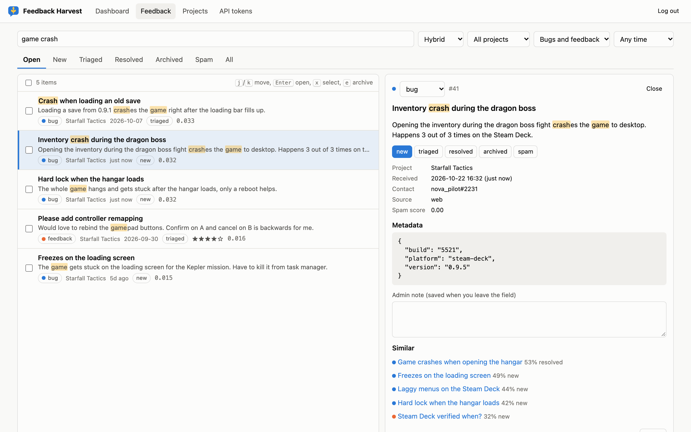
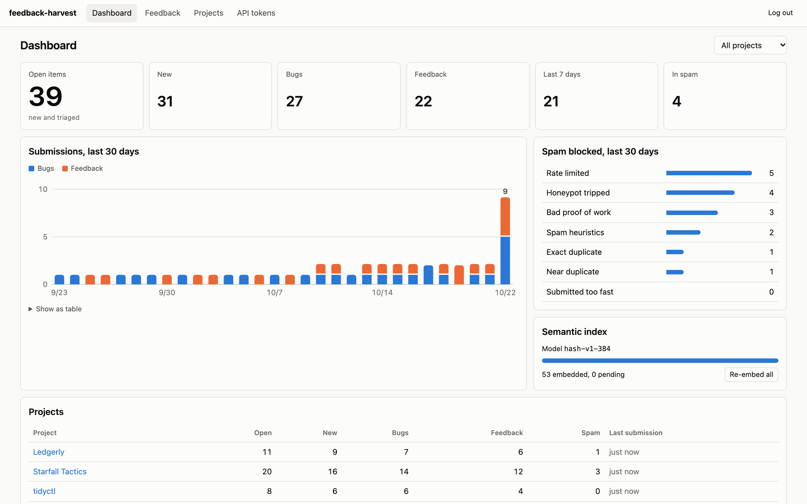
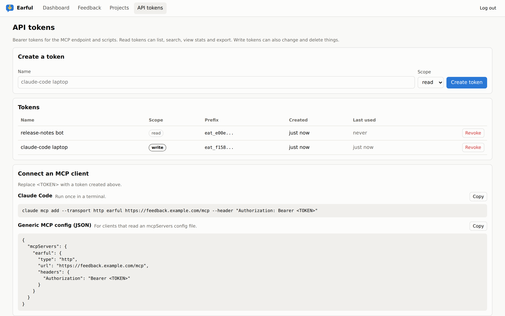

<div align="center">

<picture>
  <source media="(prefers-color-scheme: dark)" srcset="docs/assets/logo-dark.svg">
  
</picture>

**Bug reports and feedback from anything you ship, in one tiny self-hosted binary.**

[](https://github.com/georgevibing/feedback-harvest/actions/workflows/ci.yml)
[](LICENSE)
[](https://www.rust-lang.org)
[](#quickstart)
[](docs/mcp.md)

[Quickstart](#quickstart) ·
[Integrate](#integrate-a-product) ·
[Anti-spam](#how-anti-spam-works) ·
[Search](#search) ·
[MCP](#agents-via-mcp) ·
[Deploy](#deploy-on-coolify) ·
[Docs](docs/)

<br>

<picture>
  <source media="(prefers-color-scheme: dark)" srcset="docs/assets/inbox-dark.png">
  
</picture>

</div>

## Why

You launched a Steam game, a web app or a CLI and want to hear from the people using it. You do not want accounts, a SaaS subscription or a spam-filled inbox. You want a form your players can use without signing in, an inbox you can actually search, and something you can deploy in a minute and forget about.

Feedback Harvest is that: one Rust binary and one SQLite file. Users submit anonymously through a hosted page, an embeddable widget or a plain HTTP API. Layered anti-spam keeps scripts out without CAPTCHAs. A small admin UI (only you can log in) lets you manage projects and dig through submissions with fuzzy, keyword, semantic and hybrid search. Your coding agent gets the same powers through a built-in MCP server.

It is built for one person running a handful of projects on a Coolify box, not as a SaaS.

Project-scoped **labels and themes** support multi-label triage, all/any/unlabeled
filters, bulk assignment and a dashboard theme overview. Agents use the same operations
through MCP; see the [theme classification guide](docs/agent-themes.md).

## Features

**Collect**
- Projects with title, slug, type (`game`, `webapp`, `mobile`, `desktop`, `service`, `library`, `other`) and description, each with a public, rotatable ingest key. Pause intake per project.
- Bug reports and feedback with optional title, contact, 1 to 5 rating and free-form `meta` JSON (version, platform, build, GPU, whatever helps).
- Three ways in: a hosted page at `/s/<slug>`, an embeddable `widget.js` (floating button or inline form, Shadow DOM, light and dark, about 9 KB gzipped), or the HTTP API from any language.

**Stop spam**
- No accounts and no CAPTCHA, but nine layers: per-project keys, sliding window rate limits, adaptive proof of work, single-use signed challenges, a honeypot, a minimum fill time, exact duplicate merging, heuristic scoring and near duplicate detection.
- Soft signals quarantine instead of reject, and the API answers `202` for every silent outcome, so spammers learn nothing and you lose nothing.

**Find anything**
- Fuzzy find that survives typos (`invetnory crsh` finds "Inventory crash"), stemmed keyword search with BM25, semantic search over embeddings, and a hybrid mode that fuses all three.
- "Similar" reports on every item for spotting duplicates. Filters, status tabs, bulk actions, keyboard shortcuts, admin notes, CSV and JSON export.
- A dashboard with 30 day activity, blocked spam by reason and per-project counts.

**Agents via MCP**
- A built-in [Model Context Protocol](https://modelcontextprotocol.io) endpoint with 23 tools, resources and prompts. Claude Code, Cursor, VS Code or any MCP client can triage the inbox, search by meaning, import reports from Discord and draft release notes.
- Scoped (`read` or `write`), hashed, revocable API tokens managed from the admin UI.

**Ship it tiny**
- One binary of about 10 MB with the admin UI and widget embedded, SQLite in WAL mode, no other services. About 10 MB of RAM when idle with the lexical embedder, about 90 MB with the bundled semantic model loaded (measured on a macOS arm64 release build). A distroless Docker image for Coolify or any container host.
- Real semantic search fully offline: the Docker image ships a 31 MB [Model2Vec](https://github.com/MinishLab/model2vec) model (no GPU, no extra service, about 13 microseconds per embedding). OpenAI, Ollama or any OpenAI compatible server are optional upgrades.

## Screenshots

<table>
  <tr>
    <td width="50%">
      <picture>
        <source media="(prefers-color-scheme: dark)" srcset="docs/assets/dashboard-dark.png">
        
      </picture>
      <p align="center"><b>Dashboard</b>: activity, blocked spam, embedding status</p>
    </td>
    <td width="50%">
      <picture>
        <source media="(prefers-color-scheme: dark)" srcset="docs/assets/project-dark.png">
        
      </picture>
      <p align="center"><b>Project</b>: ingest key and ready to paste snippets</p>
    </td>
  </tr>
  <tr>
    <td width="50%">
      <picture>
        <source media="(prefers-color-scheme: dark)" srcset="docs/assets/hosted-dark.png">
        
      </picture>
      <p align="center"><b>Hosted page</b>: <code>/s/&lt;slug&gt;</code>, no code needed</p>
    </td>
    <td width="50%">
      <picture>
        <source media="(prefers-color-scheme: dark)" srcset="docs/assets/widget-dark.png">
        
      </picture>
      <p align="center"><b>Widget</b>: one script tag on any site</p>
    </td>
  </tr>
  <tr>
    <td width="50%">
      <picture>
        <source media="(prefers-color-scheme: dark)" srcset="docs/assets/tokens-dark.png">
        
      </picture>
      <p align="center"><b>API tokens</b>: connect an MCP client in one line</p>
    </td>
    <td width="50%">
      <picture>
        <source media="(prefers-color-scheme: dark)" srcset="docs/assets/inbox-dark.png">
        
      </picture>
      <p align="center"><b>Inbox</b>: search, triage, similar reports</p>
    </td>
  </tr>
</table>

Screenshots follow your GitHub theme. They are generated from seeded demo data by [`scripts/screenshots.mjs`](scripts/screenshots.mjs).

## Quickstart

### Docker Compose

```sh
cp .env.example .env
printf '%s' 'choose-a-long-password' | docker run --rm -i $(docker build -q .) hash-password
# paste the hash into .env in single quotes: FH_ADMIN_PASSWORD_HASH='$argon2id$v=19$...'
docker compose up -d --build
```

Open http://127.0.0.1:8080/admin/ and sign in. The compose file publishes on `127.0.0.1` only; reach it from another machine with `ssh -L 8080:127.0.0.1:8080 your-server`, or deploy behind an HTTPS proxy ([Coolify guide](docs/deploy-coolify.md)).

### From source

Prerequisites: Rust stable (rustup), Node 22+ and pnpm (`corepack enable`).

```sh
pnpm install
pnpm build:web                       # widget + admin UI, embedded into the binary
cargo build --release

export FH_ADMIN_PASSWORD_HASH="$(printf '%s' 'choose-a-long-password' | ./target/release/feedback-harvest hash-password)"
export FH_COOKIE_SECURE=false        # plain http on localhost only
./target/release/feedback-harvest serve
```

The server listens on `127.0.0.1:8080` by default. Without `FH_ADMIN_PASSWORD_HASH` every login fails, by design.

## Integrate a product

Create a project in the admin UI and copy its ingest key. The key ships inside your game or page, so it is public by design; rotate it whenever you like. The project page shows every snippet below, prefilled.

**Hosted page.** Link to `https://<your-host>/s/<slug>` from your game menu, store page or Discord. No code.

**Widget.** One script tag adds a floating feedback button to any site:

```html
<script src="https://<your-host>/widget.js" data-fh-key="fhk_..." defer></script>
```

Or render the form inline in an element you control:

```html
<div data-fh-inline data-fh-key="fhk_..."></div>
<script src="https://<your-host>/widget.js" defer></script>
```

There is also an ESM client for bundlers. See [packages/widget/README.md](packages/widget/README.md).

**Any client.** Fetch a challenge, solve a small proof of work, submit:

```sh
BASE=https://<your-host> KEY=fhk_...
CH=$(curl -s "$BASE/api/v1/challenge?key=$KEY")
TOKEN=$(echo "$CH" | jq -r .challenge) BITS=$(echo "$CH" | jq -r .bits)
NONCE=$(feedback-harvest solve "$TOKEN" "$BITS")
curl -s "$BASE/api/v1/feedback" -H 'Content-Type: application/json' -d @- <<EOF
{"key":"$KEY","kind":"bug","title":"Crash on launch","body":"Black screen, then crash to desktop.",
 "meta":{"version":"1.2.3","platform":"windows"},"challenge":"$TOKEN","nonce":"$NONCE"}
EOF
```

[docs/integrations.md](docs/integrations.md) has complete examples for Unity (C#), Godot 4 (GDScript), C++ and Python, plus advice for games (fetch the challenge when the dialog opens, put build info in `meta`). The full HTTP contract is [docs/api.md](docs/api.md).

## How anti-spam works

Every submission runs through a fixed pipeline. Hard failures that a legitimate client needs to know about return an error; everything else answers `202 {"ok": true}`.

| Layer | What it does | On failure |
| --- | --- | --- |
| Ingest key | Scopes every request to one project; rotatable, pausable | `404` / `403` |
| Honeypot | Hidden `website` field that only bots fill in | Silently dropped |
| Validation | Length caps, UTF-8, control characters stripped, `meta` at most 4 KB | `400` |
| Rate limits | Sliding windows per IP and project (minute, hour, day), per IP globally, per project globally | `429` + `Retry-After` |
| Proof of work | SHA-256 puzzle, about 0.2 s in a browser at the default 18 bits, harder for repeat senders and under load | `400` |
| Single-use challenge | HMAC-signed, project-bound, expires after 30 minutes, redeemable once | `400` |
| Minimum fill time | Submitted less than 2 s after the challenge was issued | Quarantined |
| Exact duplicate | Same text within 24 h: dropped from the same IP, merged (`+1`) from another | Dropped or merged |
| Heuristics | Links, shorteners, link markup, spam phrases, shouting, character runs, repetition | Quarantined |
| Near duplicate | Paraphrased repeats from one IP (embedding similarity of at least 0.95) | Quarantined |

Raw IP addresses are never stored, only keyed HMAC pseudonyms (IPv6 at /64 granularity). Quarantined items wait in the **Spam** tab, one click from being restored. The reasoning behind each layer is in [docs/architecture.md](docs/architecture.md).

## Search

| Mode | How | Best for |
| --- | --- | --- |
| `hybrid` (default) | Reciprocal rank fusion (k = 60) of the three below | Everyday searching |
| `fuzzy` | FTS5 trigram candidates, scored by typo-tolerant edit distance and prefix matching | Half-remembered words, typos |
| `keyword` | FTS5 with Porter stemming, BM25 ranked (title weighted higher) | Error strings, exact terms |
| `semantic` | Cosine similarity over embeddings, brute force in memory | "game freezes" finding "stuck on the loading screen" |

Embeddings are computed in the background, so submissions never wait on them. Pick a provider with `FH_EMBED_PROVIDER`:

| Provider | What it is | Cost | Quality |
| --- | --- | --- | --- |
| `model2vec` | Local [Model2Vec](https://github.com/MinishLab/model2vec) static embeddings, default model [`minishlab/potion-base-8M`](https://huggingface.co/minishlab/potion-base-8M) (MIT, 31 MB, 256 dimensions). Token lookup plus mean pooling: no transformer, no GPU, no network at runtime. | +2 MB binary, about 80 MB RAM, model loads in about 20 ms, about 13 µs per item | Real semantic matches |
| `hash` | Feature hashing over stemmed words, bigrams and character trigrams, plus a small concept map for common game and app vocabulary (crash, freeze, stuck; lag, stutter, fps). | Nothing | Lexical with a little help |
| `openai` | Any OpenAI compatible `/embeddings` API: OpenAI `text-embedding-3-small`, or a self-hosted [Ollama](https://ollama.com) with `nomic-embed-text` (LM Studio, vLLM and llama.cpp server work the same way). | API fees, or a 300 MB+ model server | Best |
| `none` | Semantic search off; keyword and fuzzy still work. | Nothing | n/a |

The default is `auto`: Model2Vec when a model exists at `FH_EMBED_MODEL_PATH`, otherwise `hash`. The Docker image bundles potion-base-8M (pinned revision, sha256 checked at build time), so containers get semantic search with zero setup. From source, fetch it once:

```bash
feedback-harvest download-model            # minishlab/potion-base-8M into models/potion-base-8M
feedback-harvest download-model minishlab/potion-retrieval-32M models/potion-retrieval-32M   # any Model2Vec repo works
```

On a test set of 17 realistic paraphrase queries over 18 feedback items (`crates/server/tests/model2vec.rs`), potion-base-8M reaches an MRR of 0.81 against 0.61 for `hash`, and ranks the right item first for 8 of the 12 queries that share no vocabulary with the built-in concept map (hash: 4 of 12). Examples it gets that `hash` cannot: "achievement didn't unlock" finds "the Steam trophy never popped", "can't log into my account" finds "invalid credentials even with the right password", "refund for double payment" finds "billed two times". The larger `potion-retrieval-32M` (129 MB) scored lower (0.73) on this data, so the small model is the default.

Vectors are tagged with their model, so switching providers or models re-embeds everything in the background. If the provider is down, submissions still land and keyword and fuzzy search keep working.

## Agents via MCP

The binary serves an MCP endpoint at `/mcp` (Streamable HTTP). Create a token under **API tokens**, then:

```sh
claude mcp add --transport http feedback-harvest https://<your-host>/mcp \
  --header "Authorization: Bearer fht_..."
```

Ask "triage the new feedback for starfall", or run the `triage_inbox` prompt.

| | |
| --- | --- |
| Read tools (10) | `list_labels`, `list_projects`, `get_project`, `list_feedback`, `search_feedback`, `get_feedback`, `find_similar_feedback`, `get_stats`, `export_feedback`, `get_integration_snippets` |
| Write tools (13) | `create_label`, `update_label`, `delete_label`, `label_feedback`, `create_project`, `update_project`, `rotate_project_key`, `delete_project`, `create_feedback`, `update_feedback`, `bulk_update_feedback`, `delete_feedback`, `reindex_embeddings` |
| Resources | `feedback-harvest://projects`, `.../projects/{slug}`, `.../feedback/{id}` |
| Prompts | `group_feedback_themes`, `triage_inbox`, `summarize_feedback`, `release_notes_from_resolved` |

Read tokens never see write tools. Destructive tools require explicit confirmation arguments. Clients that only speak stdio (Claude Desktop, for example) can use the built-in `feedback-harvest mcp-stdio` bridge. Setup for every client, the full tool reference and example workflows are in [docs/mcp.md](docs/mcp.md).

## Deploy on Coolify

1. Create an application from this repository with the **Dockerfile** build pack.
2. Set **Ports Exposes** to `8080` and do not map host ports.
3. Add persistent storage mounted at `/data`.
4. Set `FH_ADMIN_PASSWORD_HASH`, and optionally the embedding variables.
5. Attach a domain. Coolify's proxy terminates HTTPS.

The image binds `0.0.0.0:8080` inside the container, runs as a non-root user on distroless, trusts one proxy hop for client IPs, and ships a `HEALTHCHECK`. Step by step instructions, Cloudflare notes, an optional Ollama service, backups and upgrades are in [docs/deploy-coolify.md](docs/deploy-coolify.md).

## Architecture

```
  game / app / site                       you                    your agent
        |                                  |                          |
        | GET  /api/v1/challenge           | /admin (session cookie)  | /mcp (bearer token)
        | POST /api/v1/feedback            | /api/admin/*             |
        v                                  v                          v
 +-------------------------------------------------------------------------+
 |                    Feedback Harvest (one Rust binary)                   |
 |                                                                         |
 |  axum  ->  anti-spam pipeline  ->  SQLite (WAL)                         |
 |                                     |- projects, feedback, labels, tokens |
 |  embedded admin UI + widget.js      |- FTS5 porter (keyword)            |
 |                                     |- FTS5 trigram (fuzzy)             |
 |  background worker  --embeds-->     '- embeddings -> in-memory index    |
 +--------|----------------------------------------------------------------+
   embedders: Model2Vec (local, default in Docker) | hash (local)
              | OpenAI compatible /embeddings (optional: OpenAI, Ollama, ...)
```

The server is axum on tokio with rusqlite (bundled SQLite with FTS5), argon2id for the admin password and rust-embed for the web assets. The admin UI is Preact with no other runtime dependencies (about 21 KB of JavaScript gzipped). The deep dive is [docs/architecture.md](docs/architecture.md).

<details>
<summary><b>Configuration</b> (all environment variables)</summary>

<br>

Everything is configured through environment variables. [.env.example](.env.example) is a commented template.

| Variable | Default | Purpose |
| --- | --- | --- |
| `FH_BIND` | `127.0.0.1:8080` | Listen address. The Docker image sets `0.0.0.0:8080` inside the container. |
| `FH_DATABASE_PATH` | `feedback-harvest.db` | SQLite file. Image default `/data/feedback-harvest.db`. |
| `FH_ADMIN_PASSWORD_HASH` | unset | Argon2 PHC string from `feedback-harvest hash-password`. Unset means every login is rejected. |
| `FH_ADMIN_PASSWORD_HASH_FILE` | unset | File containing the hash. Takes precedence. |
| `FH_SESSION_TTL_HOURS` | `168` | Admin session lifetime. |
| `FH_COOKIE_SECURE` | `true` | `Secure` flag on the session cookie. Only disable for plain http on localhost. |
| `FH_TRUSTED_PROXY_HOPS` | `0` | Reverse proxies to trust for `X-Forwarded-For`. Image default `1`. |
| `FH_LIMIT_IP_PROJECT_MINUTE` | `3` | Submissions per IP per project per minute. |
| `FH_LIMIT_IP_PROJECT_HOUR` | `10` | Per IP per project per hour. |
| `FH_LIMIT_IP_PROJECT_DAY` | `30` | Per IP per project per day. |
| `FH_LIMIT_IP_GLOBAL_DAY` | `60` | Per IP across all projects per day. |
| `FH_LIMIT_PROJECT_HOUR` | `300` | Per project across all IPs per hour (flood guard). |
| `FH_LIMIT_CHALLENGES_IP_HOUR` | `60` | Challenges issued per IP per hour. |
| `FH_MIN_FILL_SECS` | `2` | Submissions faster than this after the challenge are quarantined. |
| `FH_SPAM_THRESHOLD` | `0.7` | Heuristic score that sends a submission to the spam bucket. |
| `FH_POW_BITS` | `18` | Base proof of work difficulty (leading zero bits). |
| `FH_POW_MAX_BITS` | `23` | Upper bound for adaptive difficulty. |
| `FH_CHALLENGE_TTL_SECS` | `1800` | Challenge lifetime. |
| `FH_EMBED_PROVIDER` | `auto` | `auto` (Model2Vec if the model exists, else `hash`), `model2vec`, `hash`, `openai` or `none`. |
| `FH_EMBED_MODEL_PATH` | `models/potion-base-8M` (Docker: `/models/potion-base-8M`) | Model2Vec model directory (`config.json`, `model.safetensors`, `tokenizer.json`). |
| `FH_EMBED_AUTO_DOWNLOAD` | `false` | With `model2vec`, download a missing model from Hugging Face at startup. |
| `FH_EMBED_DIM` | `384` | Vector size for the `hash` provider. |
| `FH_EMBED_URL` | `https://api.openai.com/v1` | Base URL of an OpenAI compatible API. |
| `FH_EMBED_MODEL` | `text-embedding-3-small` (`openai`), `minishlab/potion-base-8M` (`model2vec`) | Model name for `openai`, or the Hugging Face repo used by `FH_EMBED_AUTO_DOWNLOAD`. |
| `FH_EMBED_API_KEY` / `FH_EMBED_API_KEY_FILE` | unset | Bearer token for the embedding API. |
| `RUST_LOG` | `info` | Log filter (tracing `EnvFilter` syntax). |

Admin login attempts are limited to 5 failures per 15 minutes per IP and failed MCP token attempts to 20 per 15 minutes per IP (not configurable).

</details>

<details>
<summary><b>Security model</b></summary>

<br>

- **One admin.** The password is verified with argon2id. Sessions are random 256 bit tokens; only their SHA-256 is stored. The cookie is `HttpOnly`, `SameSite=Strict` and `Secure` by default, and state changing admin requests from a foreign `Origin` are rejected. Without a configured hash, every login fails.
- **Public by design, guarded by layers.** The ingestion API is unauthenticated because anonymous players are its audience. The anti-spam pipeline protects it instead.
- **Private by default.** The server binds `127.0.0.1` unless told otherwise. The Docker image binds `0.0.0.0` inside the container, which is fine only because Coolify publishes no host port and the compose file publishes to `127.0.0.1`. Never publish port 8080 on a public interface; go through the HTTPS proxy.
- **Strict headers.** A `self`-only Content Security Policy and `X-Frame-Options: DENY` on the admin UI, `nosniff` and `no-referrer` everywhere.
- **Agent tokens.** MCP clients use admin-issued bearer tokens with `read` or `write` scope, stored as SHA-256 and revocable instantly.

See [SECURITY.md](SECURITY.md).

</details>

<details>
<summary><b>Backups</b></summary>

<br>

All state lives in one SQLite database in WAL mode. Do not copy the `.db` file alone while the server runs, because recent writes may still be in the `-wal` file. Instead:

- Take an online snapshot: `sqlite3 /path/to/feedback-harvest.db ".backup '/backups/fh-$(date +%F).db'"`, or `VACUUM INTO '/backups/fh.db'`.
- Replicate continuously to S3 compatible storage with [Litestream](https://litestream.io) against the same volume.
- Or stop the container and copy the `.db`, `-wal` and `-shm` files together.

</details>

## Project layout

```
crates/server/      Rust server and CLI (axum, rusqlite, argon2). Binary: feedback-harvest
  src/routes/         public ingestion + hosted page, admin API, embedded assets
  src/mcp/            MCP endpoint, tools, resources, prompts, stdio bridge
  tests/              HTTP integration tests
apps/admin/         Admin UI (Preact + Vite), embedded at /admin/
packages/widget/    widget.js, ESM client and the TypeScript proof of work solver
e2e/                Playwright tests against the real binary
scripts/            Demo data seeding and README screenshots
docs/               API contract, architecture, MCP, deployment, integrations
```

A Cargo workspace for Rust and a pnpm workspace for TypeScript.

## Development

```sh
pnpm install
pnpm dev:server     # API on http://127.0.0.1:8080 (needs FH_ADMIN_PASSWORD_HASH and FH_COOKIE_SECURE=false)
pnpm dev:admin      # admin UI with hot reload on http://127.0.0.1:5173/admin/, proxies the API
```

`pnpm check` is the gate before every commit. It runs typecheck, rustfmt, clippy with `-D warnings`, the Rust unit and integration tests (113), the widget (29) and admin (31) tests, and the Playwright suite (7) against the real binary. The same steps run in [GitHub Actions](.github/workflows/ci.yml).

```sh
pnpm check          # everything
pnpm test:rust      # cargo test --workspace
pnpm test:web       # widget and admin unit tests
pnpm test:e2e       # builds web + server, then runs Playwright
pnpm screenshots              # rebuild and regenerate docs/assets
```

Conventions, invariants and gotchas for humans and coding agents are in [AGENTS.md](AGENTS.md). Contributions are welcome, see [CONTRIBUTING.md](CONTRIBUTING.md).

## Roadmap

Ideas, roughly in order of usefulness:

- Notifications: a webhook, email or Discord message for new bugs, with a daily digest option.
- Screenshot and log attachments, stored next to the database with size caps.
- Optional multilingual Model2Vec default (`potion-multilingual-128M`) for non-English communities.
- Public "known issues" page per project, generated from triaged bugs.
- Reply to the reporter from the admin UI when they left an email.

## License

[MIT](LICENSE) © 2026 George Kaltsikis
